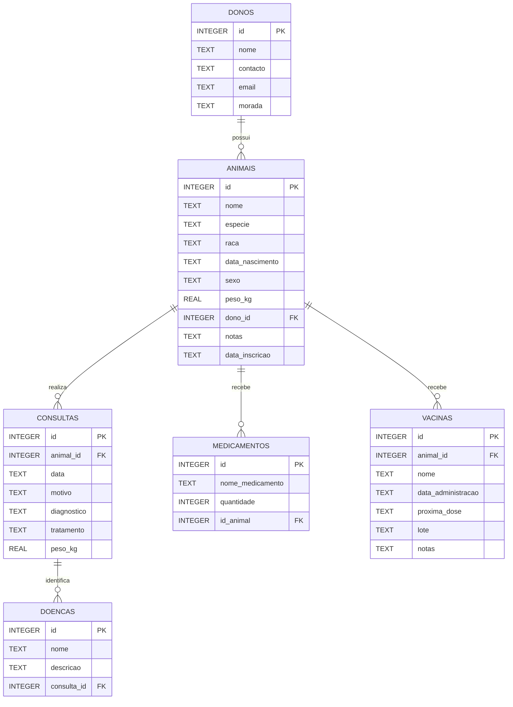

# Veterinário App

App feita em Python para a  gestão de uma clínica veterinária (donos, animais, consultas, históricos e etc.).

## Membros

- (Bruno Torrado)
- (Daniel Barros)
- (Viktor Maly)
- (Lourenco Romão)

## Como executar
Requer Python 3.10 ou superior.
Pasta principal do projeto: python src/main.py

## Estrutura

### Estrutura da Base de Dados

#### 1. Tabela `donos`

Armazena os dados dos proprietários dos animais.

| Campo | Tipo de dados | Restrições | Descrição |
|---|---|---|---|
| `id` | INTEGER | PRIMARY KEY, AUTOINCREMENT | Identificador único do dono |
| `nome` | TEXT | NOT NULL | Nome do dono |
| `contacto` | TEXT | NOT NULL | Número de contacto |
| `email` | TEXT | — | Endereço de email |
| `morada` | TEXT | — | Morada do dono |

**Restrição adicional:**
- `UNIQUE(nome, contacto)` — impede a existência de dois donos com o mesmo nome e contacto.

#### 2. Tabela `animais`

Armazena os dados dos animais registados na aplicação.

| Campo | Tipo de dados | Restrições | Descrição |
|---|---|---|---|
| `id` | INTEGER | PRIMARY KEY, AUTOINCREMENT | Identificador único do animal |
| `nome` | TEXT | NOT NULL | Nome do animal |
| `especie` | TEXT | NOT NULL | Espécie do animal |
| `raca` | TEXT | — | Raça do animal |
| `data_nascimento` | TEXT | — | Data de nascimento |
| `sexo` | TEXT | — | Sexo do animal |
| `peso_kg` | REAL | CHECK (peso_kg IS NULL OR peso_kg > 0) | Peso do animal em quilogramas |
| `dono_id` | INTEGER | NOT NULL, FOREIGN KEY | Identificador do dono |
| `notas` | TEXT | — | Observações adicionais |
| `data_inscricao` | TEXT | NOT NULL | Data de inscrição do animal |

**Relação:**
- `dono_id` referencia `donos(id)`.
- Cada animal pertence obrigatoriamente a um dono.

#### 3. Tabela `consultas`

Regista as consultas veterinárias realizadas aos animais.

| Campo | Tipo de dados | Restrições | Descrição |
|---|---|---|---|
| `id` | INTEGER | PRIMARY KEY, AUTOINCREMENT | Identificador único da consulta |
| `animal_id` | INTEGER | NOT NULL, FOREIGN KEY | Identificador do animal |
| `data` | TEXT | NOT NULL | Data da consulta |
| `motivo` | TEXT | NOT NULL | Motivo da consulta |
| `diagnostico` | TEXT | — | Diagnóstico veterinário |
| `tratamento` | TEXT | — | Tratamento recomendado |
| `peso_kg` | REAL | CHECK (peso_kg IS NULL OR peso_kg > 0) | Peso do animal na consulta |

**Relação:**
- `animal_id` referencia `animais(id)`.
- Um animal pode ter várias consultas.

#### 4. Tabela `medicamentos`

Armazena os medicamentos associados aos animais.

| Campo | Tipo de dados | Restrições | Descrição |
|---|---|---|---|
| `id` | INTEGER | PRIMARY KEY, AUTOINCREMENT | Identificador único do medicamento |
| `nome_medicamento` | TEXT | NOT NULL | Nome do medicamento |
| `quantidade` | INTEGER | — | Quantidade de medicamento |
| `id_animal` | INTEGER | FOREIGN KEY | Identificador do animal |

**Relação:**
- `id_animal` referencia `animais(id)`.
- Um animal pode ter vários medicamentos associados.

#### 5. Tabela `doencas`

Regista as doenças identificadas durante as consultas veterinárias.

| Campo | Tipo de dados | Restrições | Descrição |
|---|---|---|---|
| `id` | INTEGER | PRIMARY KEY, AUTOINCREMENT | Identificador único da doença |
| `nome` | TEXT | NOT NULL | Nome da doença |
| `descricao` | TEXT | — | Descrição da doença |
| `consulta_id` | INTEGER | NOT NULL, FOREIGN KEY | Identificador da consulta |

**Relação:**
- `consulta_id` referencia `consultas(id)`.
- Uma consulta pode ter várias doenças associadas.

#### 6. Tabela `vacinas`

Armazena o histórico de vacinação dos animais.

| Campo | Tipo de dados | Restrições | Descrição |
|---|---|---|---|
| `id` | INTEGER | PRIMARY KEY, AUTOINCREMENT | Identificador único da vacina |
| `animal_id` | INTEGER | NOT NULL, FOREIGN KEY | Identificador do animal |
| `nome` | TEXT | NOT NULL | Nome da vacina |
| `data_administracao` | TEXT | NOT NULL | Data em que a vacina foi administrada |
| `proxima_dose` | TEXT | — | Data prevista para a próxima dose |
| `lote` | TEXT | — | Número do lote da vacina |
| `notas` | TEXT | — | Observações adicionais |

**Relação:**
- `animal_id` referencia `animais(id)`.
- Um animal pode ter várias vacinas registadas.

---

#### Diagrama Entidade-Relacionamento



## Funcionalidades: marcações, colaboradores e eliminação de dados

| Story | Onde está no menu | Ficheiros |
|---|---|---|
| 9 – Marcar consulta | 3. Consultas | `src/marcacoes.py`, `src/db.py` |
| 16 – Eliminar a minha conta | 6. Eliminar a minha conta | `src/donos.py`, `src/db.py` |
| 17 – Eliminar o meu animal | 2. Animais → 9 | `src/animais.py`, `src/db.py` |
| 18 – Gerir médicos e colaboradores | 5. Administração → 7 | `src/administracao.py`, `src/db.py` |

#### Tabela `colaboradores`

| Campo | Tipo de dados | Restrições | Descrição |
|---|---|---|---|
| `id` | INTEGER | PRIMARY KEY, AUTOINCREMENT | Identificador único do colaborador |
| `nome` | TEXT | NOT NULL | Nome do colaborador |
| `funcao` | TEXT | NOT NULL | Médico veterinário, Enfermeiro, Auxiliar, Rececionista ou Outro |
| `especialidade` | TEXT | — | Especialidade (ex.: cirurgia) |
| `contacto` | TEXT | — | Número de contacto |
| `email` | TEXT | — | Endereço de email |

#### Tabela `marcacoes`

| Campo | Tipo de dados | Restrições | Descrição |
|---|---|---|---|
| `id` | INTEGER | PRIMARY KEY, AUTOINCREMENT | Identificador único da marcação |
| `animal_id` | INTEGER | NOT NULL, FOREIGN KEY | Animal da consulta |
| `data_hora` | TEXT | NOT NULL | Data e hora (AAAA-MM-DD HH:MM) |
| `motivo` | TEXT | NOT NULL | Motivo da consulta |
| `colaborador_id` | INTEGER | FOREIGN KEY, ON DELETE SET NULL | Médico escolhido (opcional) |
| `estado` | TEXT | NOT NULL, `marcada` ou `cancelada` | Estado da marcação |

**Regras:**
- Só se podem marcar consultas para datas futuras.
- Um médico (e um animal) não pode ter duas consultas marcadas à mesma hora.
- Cancelar uma marcação não a apaga: o estado passa a `cancelada`.
- Eliminar um animal apaga também as suas consultas, doenças, vacinas, medicamentos e marcações.
- Eliminar a conta apaga o dono e todos os seus animais (com os dados acima).
- Se um colaborador for eliminado, as suas marcações ficam sem médico atribuído.

## Pré-requisitos e dependências

- **Python**: 3.10 ou superior (o projeto foi desenvolvido com Python 3.12).
- **SQLite**: incluído na instalação padrão do Python; base de dados SQLite (`veterinario.db`) criada automaticamente.
- **reportlab**: biblioteca opcional, necessária apenas para exportar fichas de animais em PDF (`pip install reportlab`).

## Instalação e configuração

1. (Opcional) Crie e ative um ambiente virtual:
   ```bash
   python -m venv .venv
   source .venv/bin/activate  # Linux/macOS
   # .venv\Scripts\activate   # Windows
   ```
2. Instale as dependências opcionais:
   ```bash
   pip install reportlab
   ```
3. Execute a aplicação:
   ```bash
   python src/main.py
   ```

## Como executar localmente

Ao iniciar, a aplicação apresenta um menu de autenticação com as seguintes opções:
- **Login**: acede com o nome de utilizador existente.
- **Registar**: cria um novo dono (necessário nome e contacto).
- **Sair**: termina o programa.

Após login, o menu principal oferece acesso às seguintes áreas:
- **1. Donos**: registo, listagem e atualização de donos.
- **2. Animais**: registo, listagem, pesquisa, consulta situação, atualização e eliminação.
- **3. Consultas**: marcação, listagem e cancelamento de consultas.
- **4. Históricos**: consulta de medicamentos e histórico de doenças.
- **5. Administração**: área protegida por palavra-passe com gestão de animais, donos, fornecedores, produtos e colaboradores.
- **6. Eliminar a minha conta**: apaga o dono, os seus animais e todo o historial (story 16).
- **0. Sair**: termina a aplicação.

## Estrutura de diretórios

```
Veterinario-app/
├── docs/                # Documentação gerada com Sphinx
│   ├── conf.py
│   ├── index.rst
│   ├── Makefile
│   ├── make.bat
│   └── api/             # Páginas de módulos automaticamente geradas
├── src/                 # Código-fonte principal
│   ├── main.py          # Ponto de entrada; autenticação e menu principal
│   ├── menu.py          # Menu principal e navegação
│   ├── db.py            # Ligação à base de dados e criação de tabelas
│   ├── donos.py         # Gestão de donos (registo, listagem, atualização, eliminação)
│   ├── animais.py       # Gestão de animais, consultas, vacinas e exportação PDF
│   ├── marcacoes.py     # Marcação, listagem e cancelamento de consultas
│   ├── administracao.py # Área de administração (fornecedores, produtos, colaboradores)
│   └── historicos/      # Histórico de medicamentos e doenças
│       ├── __init__.py
│       ├── historicos.py
│       └── menu.py
├── tests/               # Espaço reservado para testes automatizados (sem suite atual)
├── .gitignore           # Ficheiros ignorados pelo Git (__, *.pyc, .venv, *.db, .idea, .vscode)
└── veterinario.db       # Base de dados SQLite (criada automaticamente; ignorada no git)
```

## Arquitetura e principais componentes

- **main.py**: Coordena o ponto de entrada, a autenticação e o fluxo para o menu principal.
- **menu.py**: Apresenta o menu global e encaminha para submenus de donos, animais, consultas, históricos, administração e eliminação de conta.
- **db.py**: Gerencia a ligação SQLite, criação de tabelas (`criar_tabelas`, `criar_tabela_colaboradores`, `criar_tabela_marcacoes`), e operações CRUD (`executar`, `consultar`).
- **donos.py**: Operações sobre a tabela `donos`: adicionar, listar, atualizar, eliminar conta e respetivos dados.
- **animais.py**: Tabela `animais`, consultas, vacinas; funcionalidades: registo de animal, consulta, vacina, exportação PDF, listagem e pesquisa.
- **marcacoes.py**: Tabela `marcacoes`; permite marcar consultas (com validação de datas futuras e disponibilidade de médicos/animais), listar e cancelar (mudança de estado para `cancelada`).
- **administracao.py**: Tabelas `fornecedores` e `produtos`; área protegida por palavra-passe (`getpass`, hash SHA-256); gestão de colaboradores (registo, atualização, eliminação).
- **historicos/historicos.py**: Funções auxiliares `mostrar_medicamentos` e `mostrar_historico_doencas` que consultam a base de dados e apresentam resumos no terminal.
- **historicos/menu.py**: Menu de contexto para exibição de medicamentos e doenças.

## Utilização e comandos disponíveis

### Menu de autenticação
```
1. Login - solicita o nome; verifica existência na base de dados.
2. Registar - pede nome, contacto, email (opcional) e morada (opcional).
0. Sair - termina o programa.
```

### Menu principal (após login)
```
1. Donos - abre submenu de gestão de donos.
2. Animais - abre menu de gestão de animais (sub-menus de registo, listagem, pesquisa, consulta, vacina, situação, exportar PDF, atualizar, eliminar).
3. Consultas - abre submenu de marcação/listagem/cancelamento (story 9).
4. Históricos - abre menu de consulta de medicamentos e histórico de doenças.
5. Administração - abre menu protegido por palavra-passe (hash SHA-256 predefinido).
6. Eliminar a minha conta - apaga conta do dono e todos os seus dados (story 16).
0. Sair - termina a aplicação.
```

### Área de Administração (protegida por palavra-passe)
Acesso mediante validação de hash SHA-256 da palavra-passe introduzida. Menu inclui:
- 1. Quantos animais estão registados
- 2. Listar todos os animais
- 3. Pesquisar animais
- 4. Listar todos os donos
- 5. Gerir fornecedores (registo, listagem, atualização, eliminação)
- 6. Gerir produtos (registo, listagem, atualização, eliminação)
- 7. Gerir médicos e colaboradores (registo, listagem, atualização, eliminação)
- 0. Voltar

## Testes

Não existe atualmente uma suite de testes automatizada no projeto. A pasta `tests/` contém apenas um ficheiro `.gitkeep` reservado para futuros testes. Validação manual é feita através da execução da aplicação e verificação das funcionalidades listadas acima.

## Build e deploy

Não existe um passo de build compilado. A aplicação é um script Python de linha de comando.

- **Build da documentação Sphinx**: `cd docs && make html` (gera os ficheiros HTML na pasta `_build/html/`; requer `sphinx` e `sphinx-alabaster-theme`).
- **Deploy**: cloner o repositório, criar um ambiente virtual, instalar opcionalmente `reportlab` e executar `python src/main.py`.

## Como contribuir

1. Crie a sua branch a partir de `main`: `git checkout -b ai/fix-issue-<numero>`.
2. Crie commits com mensagens claras e concisas.
3. Não modifique ficheiros de segredos, CI/CD, segredos ou dependências de segurança a menos que estritamente necessário.
4. Teste as alterações executando `python src/main.py` e verify a documentação.
5. Envie um Pull Request para o repositório original, descrevendo:
   - O problema abordado (issue #33).
   - As alterações realizadas.
   - Como testou as alterações.
6. Siga as convenções de commit do repositório e evite commits que misturem tipos de alteração (docs vs código) a menos que sejam intimamente relacionados.

## Licença

Este projeto destina-se a ser utilizado como trabalho prático da unidade curricular de Ambientes de Desenvolvimento Colaborativo. Consulte o repositório para mais detalhes.