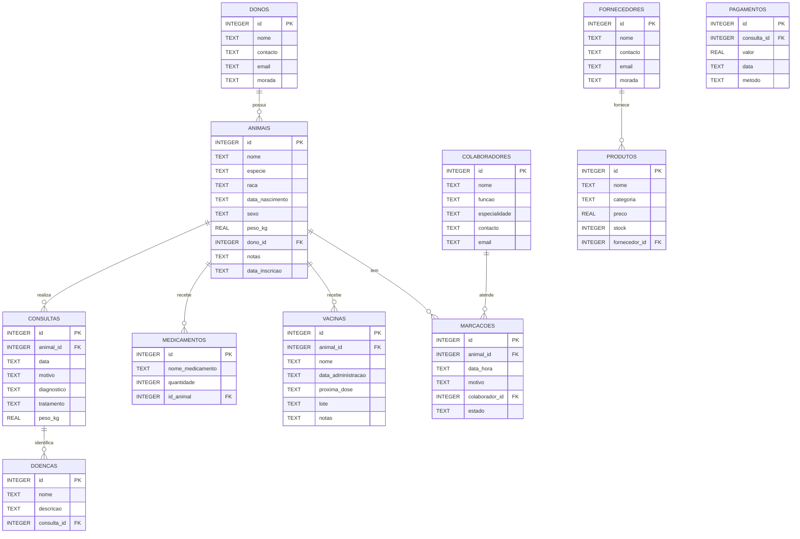

# Veterinário App

Aplicação em Python, para a consola, que gere uma clínica veterinária: donos, animais, consultas e marcações,
vacinas, históricos de doenças e medicamentos, colaboradores, fornecedores e produtos.

Trabalho prático TP2 do **grupo H**, na unidade curricular de Ambientes de Desenvolvimento Colaborativo (ADC).

## Membros

- Bruno Torrado
- Daniel Barros
- Viktor Maly
- Lourenço Romão

## Como executar

Requer Python 3.10 ou superior. Na pasta principal do projeto:

```bash
pip install reportlab
python src/main.py
```

O `reportlab` só é necessário para exportar a ficha de um animal em PDF.
A base de dados SQLite (`veterinario.db`) é criada automaticamente na primeira execução.

## Menus da aplicação

Ao iniciar, o utilizador faz **login** ou **regista-se** (identificação pelo nome do dono).
Depois entra no menu principal:

| Opção | Área | O que permite |
|---|---|---|
| 1 | Donos | Registar, listar e atualizar donos |
| 2 | Animais | Registar, listar, pesquisar, atualizar e eliminar animais; registar consultas e vacinas; consultar a situação atual; exportar a ficha em PDF |
| 3 | Consultas | Marcar, listar e cancelar marcações de consultas |
| 4 | Históricos | Ver o histórico de doenças e de medicamentos dos animais |
| 5 | Administração | Contar e listar animais, listar donos, gerir fornecedores, produtos e colaboradores (pede palavra-passe) |
| 6 | Eliminar a minha conta | Apaga o dono e todos os seus dados |
| 0 | Sair | Termina a aplicação |

Ao entrar, a aplicação avisa também quais dos animais do utilizador têm medicação registada.

## Funcionalidades

### Estado das user stories

| Nº | Story | Responsável | Estado |
|---|---|---|---|
| 1 | Menu para navegar na aplicação | Bruno | Feita |
| 2 | Guardar informações do dono | Bruno | Feita |
| 3 | Guardar informações dos animais | Daniel | Feita |
| 4 | Log in | Viktor | Feita |
| 5 | Consultar informações do animal | Daniel | Feita |
| 6 | Vários animais por utilizador | Daniel | Feita |
| 7 | Verificar vacinas em dia | Daniel | Parcial: registo de vacinas com data da próxima dose, visível na situação do animal |
| 8 | Contar animais registados | Bruno | Feita |
| 9 | Marcar consulta | Viktor | Feita |
| 10 | Histórico de doenças | Lourenço | Feita |
| 11 | Histórico de medicamentos | Lourenço | Feita |
| 12 | Pagamentos de consultas | Lourenço | Feita |
| 13 | Lembretes de medicamentos | Lourenço | Feita |
| 14 | Menu de administração | Bruno | Feita |
| 15 | Atualizar dados do dono e do animal | Bruno | Feita |
| 16 | Eliminar conta e dados | Viktor | Feita |
| 17 | Eliminar registo do animal | Viktor | Feita |
| 18 | Atualizar médicos e colaboradores | Viktor | Feita |
| 19 | Exportar ficha em PDF | Daniel | Feita |

### Contribuições por membro

**Bruno Torrado**
- **Stories:** 1, 2, 8, 14, 15
- **Ficheiros:** `src/menu.py`, `src/donos.py`, `src/administracao.py`, `src/db.py` (base), `atualizar_animal` em `src/animais.py` e `docs/` (documentação Sphinx)
- **O que faz:** menu principal, registo e atualização de donos e de animais, e área de administração
  (contagem e listagem de animais, listagem de donos, gestão de fornecedores e produtos), protegida por palavra-passe.

**Daniel Barros**
- **Stories:** 3, 5, 6, 7, 19
- **Ficheiros:** `src/animais.py`
- **O que faz:** registo, listagem e pesquisa de animais, consulta da situação atual, registo de consultas e vacinas,
  e exportação da ficha em PDF.

**Viktor Maly**
- **Stories:** 4 , 9, 16, 17, 18
- **Ficheiros:** `src/marcacoes.py`, `src/db.py` e partes de `src/donos.py`, `src/animais.py` e `src/administracao.py`
- **O que faz:** marcação, listagem e cancelamento de consultas; eliminação de conta e de animais (com todos os dados associados);
  gestão de médicos e colaboradores na administração.

**Lourenço Romão**
- **Stories:** 10, 11, 12 , 13 
- **Ficheiros:** `src/historicos/`, `src/main.py` `src/pagamentos.py`e partes de `src/db.py` e `src/animais.py`
- **O que faz:** histórico de doenças e de medicamentos, registo de doenças nas consultas, login e registo,
  e aviso ao entrar dos animais a tomar medicação e pagamentos de consultas (registo, listagem e resumo mensal) e lembretes de medicação.

## Administração

A opção "Administração" do menu principal pede uma palavra-passe de administrador.
Só o hash (SHA-256) da palavra-passe fica guardado no código, e a palavra-passe em si não.

As tabelas `fornecedores` e `produtos` são criadas pela própria área de administração, na primeira vez que se entra.

A tabela pagamentos é criada ao abrir 'Gerir pagamentos'.

## Fluxo de trabalho (Git)

- `main`: versão estável da aplicação.
- Uma branch por tarefa, criada a partir da `main`: `feature/...` (funcionalidades), `fix/...` (correções) e `docs/...` (documentação).
- Todas as alterações entram na `main` através de **pull requests**.
- Cada story tem uma issue associada, e as mensagens de commit descrevem o que foi feito.

Mais detalhes (como clonar, políticas de branches, cheat-sheet) na wiki do repositório.

## Estrutura do projeto

```text
Veterinario-app/
├── README.md
├── .gitignore
├── src/
│   ├── main.py             # ponto de entrada e autenticação (login e registo)
│   ├── menu.py             # menu principal
│   ├── db.py               # ligação à base de dados e tabelas
│   ├── donos.py            # gestão de donos
│   ├── animais.py          # animais, consultas, vacinas e PDF
│   ├── marcacoes.py        # marcação, listagem e cancelamento de consultas
│   ├── pagamentos.py       # pagamentos de consultas
│   ├── administracao.py    # administração (protegida por palavra-passe)
│   └── historicos/
│       ├── __init__.py
│       ├── historicos.py   # histórico de doenças e medicamentos
│       └── menu.py         # menu dos históricos
├── tests/                  # testes (por preencher)
└── docs/                   # documentação gerada com Sphinx
    ├── conf.py
    ├── index.rst
    ├── api/
    └── _build/html/        # páginas HTML geradas
```

O ficheiro `veterinario.db` é criado automaticamente ao executar a aplicação e não está no repositório.

## Documentação do código

A documentação é gerada com o Sphinx a partir das docstrings. Para a gerar de novo, na pasta principal do projeto:

```bash
python -m pip install sphinx
python -m sphinx.ext.apidoc -o docs/api src
python -m sphinx -b html docs docs/_build/html
```

A página inicial fica em `docs/_build/html/index.html`.

## Estrutura da Base de Dados

### 1. Tabela `donos`

Armazena os dados dos proprietários dos animais.

| Campo | Tipo de dados | Restrições | Descrição |
|---|---|---|---|
| `id` | INTEGER | PRIMARY KEY, AUTOINCREMENT | Identificador único do dono |
| `nome` | TEXT | NOT NULL | Nome do dono |
| `contacto` | TEXT | NOT NULL | Número de contacto |
| `email` | TEXT | — | Endereço de email |
| `morada` | TEXT | — | Morada do dono |

**Restrição adicional:**
- `UNIQUE(nome, contacto)`: impede a existência de dois donos com o mesmo nome e contacto.

### 2. Tabela `animais`

Armazena os dados dos animais registados na aplicação.

| Campo | Tipo de dados | Restrições | Descrição |
|---|---|---|---|
| `id` | INTEGER | PRIMARY KEY, AUTOINCREMENT | Identificador único do animal |
| `nome` | TEXT | NOT NULL | Nome do animal |
| `especie` | TEXT | NOT NULL | Espécie do animal |
| `raca` | TEXT | — | Raça do animal |
| `data_nascimento` | TEXT | — | Data de nascimento |
| `sexo` | TEXT | — | Sexo do animal |
| `peso_kg` | REAL | CHECK (peso_kg IS NULL OR peso_kg > 0) | Peso do animal em quilogramas |
| `dono_id` | INTEGER | NOT NULL, FOREIGN KEY | Identificador do dono |
| `notas` | TEXT | — | Observações adicionais |
| `data_inscricao` | TEXT | NOT NULL | Data de inscrição do animal |

**Relação:**
- `dono_id` referencia `donos(id)`.
- Cada animal pertence obrigatoriamente a um dono.

### 3. Tabela `consultas`

Regista as consultas veterinárias realizadas aos animais.

| Campo | Tipo de dados | Restrições | Descrição |
|---|---|---|---|
| `id` | INTEGER | PRIMARY KEY, AUTOINCREMENT | Identificador único da consulta |
| `animal_id` | INTEGER | NOT NULL, FOREIGN KEY | Identificador do animal |
| `data` | TEXT | NOT NULL | Data da consulta |
| `motivo` | TEXT | NOT NULL | Motivo da consulta |
| `diagnostico` | TEXT | — | Diagnóstico veterinário |
| `tratamento` | TEXT | — | Tratamento recomendado |
| `peso_kg` | REAL | CHECK (peso_kg IS NULL OR peso_kg > 0) | Peso do animal na consulta |

**Relação:**
- `animal_id` referencia `animais(id)`.
- Um animal pode ter várias consultas.

### 4. Tabela `medicamentos`

Armazena os medicamentos associados aos animais.

| Campo | Tipo de dados | Restrições | Descrição |
|---|---|---|---|
| `id` | INTEGER | FOREIGN KEY, ON DELETE CASCADE | Identificador único do medicamento |
| `nome_medicamento` | TEXT | NOT NULL | Nome do medicamento |
| `quantidade` | INTEGER | — | Quantidade de medicamento |
| `id_animal` | INTEGER | FOREIGN KEY | Identificador do animal |
| `horario` | TEXT | — | Horário da toma (ex.: 08:00, 20:00) |
| `data_fim` | TEXT | — | Data de fim do tratamento (AAAA-MM-DD) |

**Relação:**
- `id_animal` referencia `animais(id)`.
- Um animal pode ter vários medicamentos associados.

### 5. Tabela `doencas`

Regista as doenças identificadas durante as consultas veterinárias.

| Campo | Tipo de dados | Restrições | Descrição |
|---|---|---|---|
| `id` | INTEGER | PRIMARY KEY, AUTOINCREMENT | Identificador único da doença |
| `nome` | TEXT | NOT NULL | Nome da doença |
| `descricao` | TEXT | — | Descrição da doença |
| `consulta_id` | INTEGER | NOT NULL, FOREIGN KEY | Identificador da consulta |

**Relação:**
- `consulta_id` referencia `consultas(id)`.
- Uma consulta pode ter várias doenças associadas.

### 6. Tabela `vacinas`

Armazena o histórico de vacinação dos animais.

| Campo | Tipo de dados | Restrições | Descrição |
|---|---|---|---|
| `id` | INTEGER | PRIMARY KEY, AUTOINCREMENT | Identificador único da vacina |
| `animal_id` | INTEGER | NOT NULL, FOREIGN KEY | Identificador do animal |
| `nome` | TEXT | NOT NULL | Nome da vacina |
| `data_administracao` | TEXT | NOT NULL | Data em que a vacina foi administrada |
| `proxima_dose` | TEXT | — | Data prevista para a próxima dose |
| `lote` | TEXT | — | Número do lote da vacina |
| `notas` | TEXT | — | Observações adicionais |

**Relação:**
- `animal_id` referencia `animais(id)`.
- Um animal pode ter várias vacinas registadas.

### 7. Tabela `colaboradores`

Médicos e restantes colaboradores da clínica.

| Campo | Tipo de dados | Restrições | Descrição |
|---|---|---|---|
| `id` | INTEGER | PRIMARY KEY, AUTOINCREMENT | Identificador único do colaborador |
| `nome` | TEXT | NOT NULL | Nome do colaborador |
| `funcao` | TEXT | NOT NULL | Médico veterinário, Enfermeiro, Auxiliar, Rececionista ou Outro |
| `especialidade` | TEXT | — | Especialidade (ex.: cirurgia) |
| `contacto` | TEXT | — | Número de contacto |
| `email` | TEXT | — | Endereço de email |

### 8. Tabela `marcacoes`

Marcações de consultas.

| Campo | Tipo de dados | Restrições | Descrição |
|---|---|---|---|
| `id` | INTEGER | PRIMARY KEY, AUTOINCREMENT | Identificador único da marcação |
| `animal_id` | INTEGER | NOT NULL, FOREIGN KEY | Animal da consulta |
| `data_hora` | TEXT | NOT NULL | Data e hora (AAAA-MM-DD HH:MM) |
| `motivo` | TEXT | NOT NULL | Motivo da consulta |
| `colaborador_id` | INTEGER | FOREIGN KEY, ON DELETE SET NULL | Médico escolhido (opcional) |
| `estado` | TEXT | NOT NULL, `marcada` ou `cancelada` | Estado da marcação |

**Regras:**
- Só se podem marcar consultas para datas futuras.
- Um médico (e um animal) não pode ter duas consultas marcadas à mesma hora.
- Cancelar uma marcação não a apaga: o estado passa a `cancelada`.
- Eliminar um animal apaga também as suas consultas, doenças, vacinas, medicamentos e marcações.
- Eliminar a conta apaga o dono e todos os seus animais (com os dados acima).
- Se um colaborador for eliminado, as suas marcações ficam sem médico atribuído.

### 9. Tabela `fornecedores`

Fornecedores da clínica (criada pela área de administração).

| Campo | Tipo de dados | Restrições | Descrição |
|---|---|---|---|
| `id` | INTEGER | PRIMARY KEY, AUTOINCREMENT | Identificador único do fornecedor |
| `nome` | TEXT | NOT NULL, UNIQUE | Nome do fornecedor |
| `contacto` | TEXT | — | Contacto |
| `email` | TEXT | — | Endereço de email |
| `morada` | TEXT | — | Morada |

### 10. Tabela `produtos`

Produtos em stock na clínica (criada pela área de administração).

| Campo | Tipo de dados | Restrições | Descrição |
|---|---|---|---|
| `id` | INTEGER | PRIMARY KEY, AUTOINCREMENT | Identificador único do produto |
| `nome` | TEXT | NOT NULL | Nome do produto |
| `categoria` | TEXT | — | Categoria |
| `preco` | REAL | NOT NULL, CHECK (preco >= 0) | Preço em euros |
| `stock` | INTEGER | NOT NULL, DEFAULT 0, CHECK (stock >= 0) | Quantidade em stock |
| `fornecedor_id` | INTEGER | FOREIGN KEY | Fornecedor do produto |

### 11. Tabela `pagamentos`

Pagamentos das consultas (criada pela área de administração).

| Campo | Tipo de dados | Restrições | Descrição |
|---|---|---|---|
| `id` | INTEGER | PRIMARY KEY, AUTOINCREMENT | Identificador único do pagamento |
| `consulta_id` | INTEGER | NOT NULL, FOREIGN KEY, ON DELETE CASCADE | Consulta paga |
| `valor` | REAL | NOT NULL, CHECK (valor > 0) | Valor em euros |
| `data` | TEXT | NOT NULL | Data do pagamento |
| `metodo` | TEXT | NOT NULL | `dinheiro`, `multibanco` ou `MB Way` |

**Relação:** `consulta_id` referencia `consultas(id)`. A aplicação só permite um pagamento por consulta.

**Relação:**
- `fornecedor_id` referencia `fornecedores(id)`.
- Um fornecedor pode ter vários produtos.

### Diagrama Entidade-Relacionamento



## Limitações conhecidas

- A identificação dos utilizadores é feita apenas pelo nome do dono, sem palavra-passe.
- A interface é de terminal, como pedido no enunciado (sem ambiente gráfico).
- **Story 7 (vacinas em dia):** a aplicação regista a data da próxima dose, mas não faz um alerta automático de vacinas em atraso.
- A pasta `tests/` ainda não tem testes automáticos.