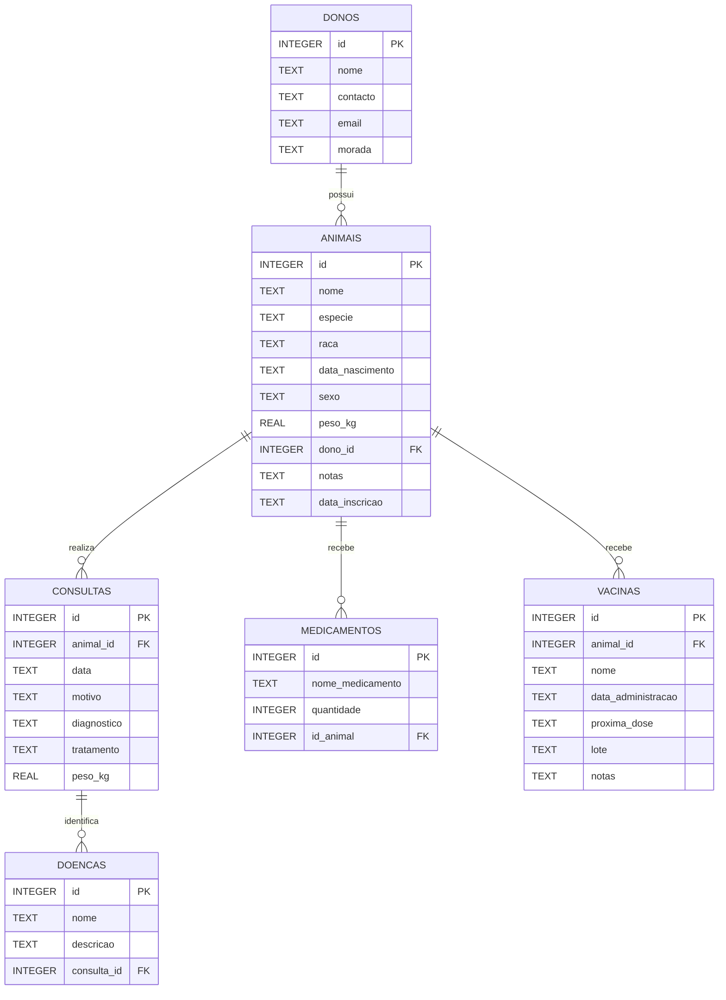

# Veterinário App

App feita em Python para a  gestão de uma clínica veterinária (donos, animais, consultas, históricos e etc.).

## Membros

- (Bruno Torrado)
- (Daniel Barros)
- (Viktor Maly)
- (Lourenco Romão)

## Como executar
Requer Python 3.10 ou superior.
Pasta principal do projeto: python src/main.py

## Estrutura

### Estrutura da Base de Dados

#### 1. Tabela `donos`

Armazena os dados dos proprietários dos animais.

| Campo | Tipo de dados | Restrições | Descrição |
|---|---|---|---|
| `id` | INTEGER | PRIMARY KEY, AUTOINCREMENT | Identificador único do dono |
| `nome` | TEXT | NOT NULL | Nome do dono |
| `contacto` | TEXT | NOT NULL | Número de contacto |
| `email` | TEXT | — | Endereço de email |
| `morada` | TEXT | — | Morada do dono |

**Restrição adicional:**
- `UNIQUE(nome, contacto)` — impede a existência de dois donos com o mesmo nome e contacto.

#### 2. Tabela `animais`

Armazena os dados dos animais registados na aplicação.

| Campo | Tipo de dados | Restrições | Descrição |
|---|---|---|---|
| `id` | INTEGER | PRIMARY KEY, AUTOINCREMENT | Identificador único do animal |
| `nome` | TEXT | NOT NULL | Nome do animal |
| `especie` | TEXT | NOT NULL | Espécie do animal |
| `raca` | TEXT | — | Raça do animal |
| `data_nascimento` | TEXT | — | Data de nascimento |
| `sexo` | TEXT | — | Sexo do animal |
| `peso_kg` | REAL | CHECK (peso_kg IS NULL OR peso_kg > 0) | Peso do animal em quilogramas |
| `dono_id` | INTEGER | NOT NULL, FOREIGN KEY | Identificador do dono |
| `notas` | TEXT | — | Observações adicionais |
| `data_inscricao` | TEXT | NOT NULL | Data de inscrição do animal |

**Relação:**
- `dono_id` referencia `donos(id)`.
- Cada animal pertence obrigatoriamente a um dono.

#### 3. Tabela `consultas`

Regista as consultas veterinárias realizadas aos animais.

| Campo | Tipo de dados | Restrições | Descrição |
|---|---|---|---|
| `id` | INTEGER | PRIMARY KEY, AUTOINCREMENT | Identificador único da consulta |
| `animal_id` | INTEGER | NOT NULL, FOREIGN KEY | Identificador do animal |
| `data` | TEXT | NOT NULL | Data da consulta |
| `motivo` | TEXT | NOT NULL | Motivo da consulta |
| `diagnostico` | TEXT | — | Diagnóstico veterinário |
| `tratamento` | TEXT | — | Tratamento recomendado |
| `peso_kg` | REAL | CHECK (peso_kg IS NULL OR peso_kg > 0) | Peso do animal na consulta |

**Relação:**
- `animal_id` referencia `animais(id)`.
- Um animal pode ter várias consultas.

#### 4. Tabela `medicamentos`

Armazena os medicamentos associados aos animais.

| Campo | Tipo de dados | Restrições | Descrição |
|---|---|---|---|
| `id` | INTEGER | PRIMARY KEY, AUTOINCREMENT | Identificador único do medicamento |
| `nome_medicamento` | TEXT | NOT NULL | Nome do medicamento |
| `quantidade` | INTEGER | — | Quantidade de medicamento |
| `id_animal` | INTEGER | FOREIGN KEY | Identificador do animal |

**Relação:**
- `id_animal` referencia `animais(id)`.
- Um animal pode ter vários medicamentos associados.

#### 5. Tabela `doencas`

Regista as doenças identificadas durante as consultas veterinárias.

| Campo | Tipo de dados | Restrições | Descrição |
|---|---|---|---|
| `id` | INTEGER | PRIMARY KEY, AUTOINCREMENT | Identificador único da doença |
| `nome` | TEXT | NOT NULL | Nome da doença |
| `descricao` | TEXT | — | Descrição da doença |
| `consulta_id` | INTEGER | NOT NULL, FOREIGN KEY | Identificador da consulta |

**Relação:**
- `consulta_id` referencia `consultas(id)`.
- Uma consulta pode ter várias doenças associadas.

#### 6. Tabela `vacinas`

Armazena o histórico de vacinação dos animais.

| Campo | Tipo de dados | Restrições | Descrição |
|---|---|---|---|
| `id` | INTEGER | PRIMARY KEY, AUTOINCREMENT | Identificador único da vacina |
| `animal_id` | INTEGER | NOT NULL, FOREIGN KEY | Identificador do animal |
| `nome` | TEXT | NOT NULL | Nome da vacina |
| `data_administracao` | TEXT | NOT NULL | Data em que a vacina foi administrada |
| `proxima_dose` | TEXT | — | Data prevista para a próxima dose |
| `lote` | TEXT | — | Número do lote da vacina |
| `notas` | TEXT | — | Observações adicionais |

**Relação:**
- `animal_id` referencia `animais(id)`.
- Um animal pode ter várias vacinas registadas.

---

#### Diagrama Entidade-Relacionamento

## Funcionalidades: marcações, colaboradores e eliminação de dados

| Story | Onde está no menu | Ficheiros |
|---|---|---|
| 9 – Marcar consulta | 3. Consultas | `src/marcacoes.py`, `src/db.py` |
| 16 – Eliminar a minha conta | 6. Eliminar a minha conta | `src/donos.py`, `src/db.py` |
| 17 – Eliminar o meu animal | 2. Animais → 9 | `src/animais.py`, `src/db.py` |
| 18 – Gerir médicos e colaboradores | 5. Administração → 7 | `src/administracao.py`, `src/db.py` |

#### Tabela `colaboradores`

| Campo | Tipo de dados | Restrições | Descrição |
|---|---|---|---|
| `id` | INTEGER | PRIMARY KEY, AUTOINCREMENT | Identificador único do colaborador |
| `nome` | TEXT | NOT NULL | Nome do colaborador |
| `funcao` | TEXT | NOT NULL | Médico veterinário, Enfermeiro, Auxiliar, Rececionista ou Outro |
| `especialidade` | TEXT | — | Especialidade (ex.: cirurgia) |
| `contacto` | TEXT | — | Número de contacto |
| `email` | TEXT | — | Endereço de email |

#### Tabela `marcacoes`

| Campo | Tipo de dados | Restrições | Descrição |
|---|---|---|---|
| `id` | INTEGER | PRIMARY KEY, AUTOINCREMENT | Identificador único da marcação |
| `animal_id` | INTEGER | NOT NULL, FOREIGN KEY | Animal da consulta |
| `data_hora` | TEXT | NOT NULL | Data e hora (AAAA-MM-DD HH:MM) |
| `motivo` | TEXT | NOT NULL | Motivo da consulta |
| `colaborador_id` | INTEGER | FOREIGN KEY, ON DELETE SET NULL | Médico escolhido (opcional) |
| `estado` | TEXT | NOT NULL, `marcada` ou `cancelada` | Estado da marcação |

**Regras:**
- Só se podem marcar consultas para datas futuras.
- Um médico (e um animal) não pode ter duas consultas marcadas à mesma hora.
- Cancelar uma marcação não a apaga: o estado passa a `cancelada`.
- Eliminar um animal apaga também as suas consultas, doenças, vacinas, medicamentos e marcações.
- Eliminar a conta apaga o dono e todos os seus animais (com os dados acima).
- Se um colaborador for eliminado, as suas marcações ficam sem médico atribuído.